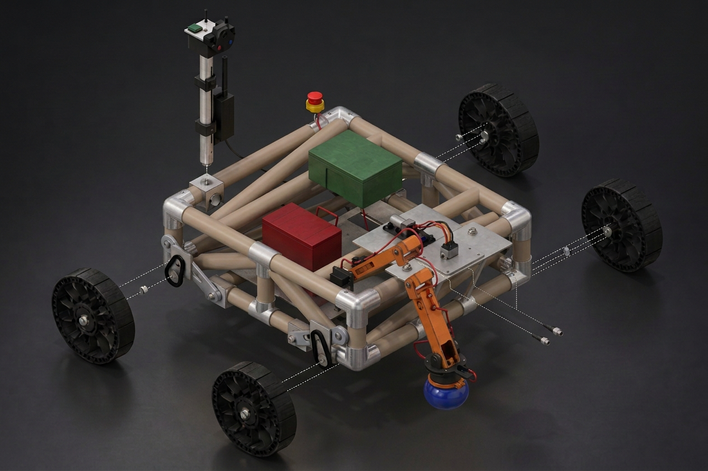
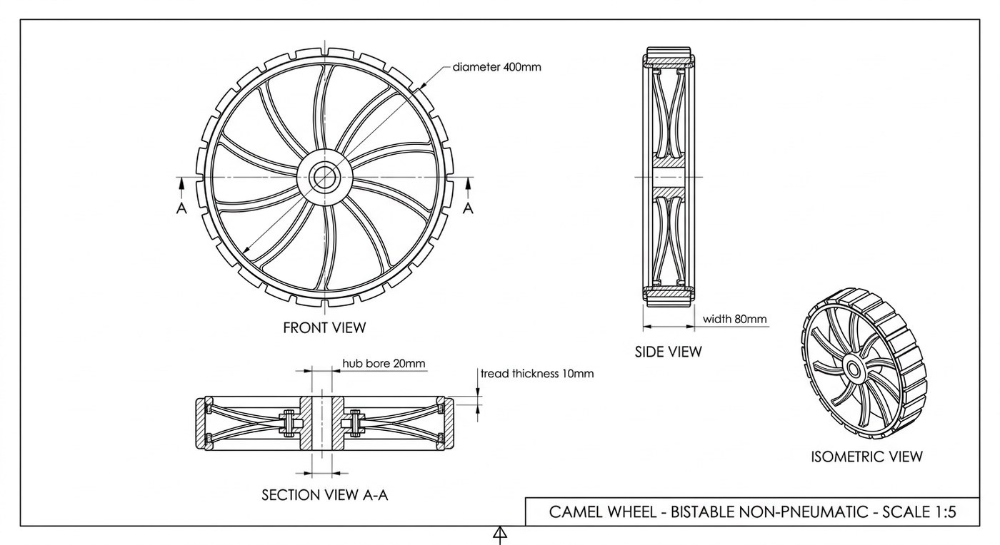
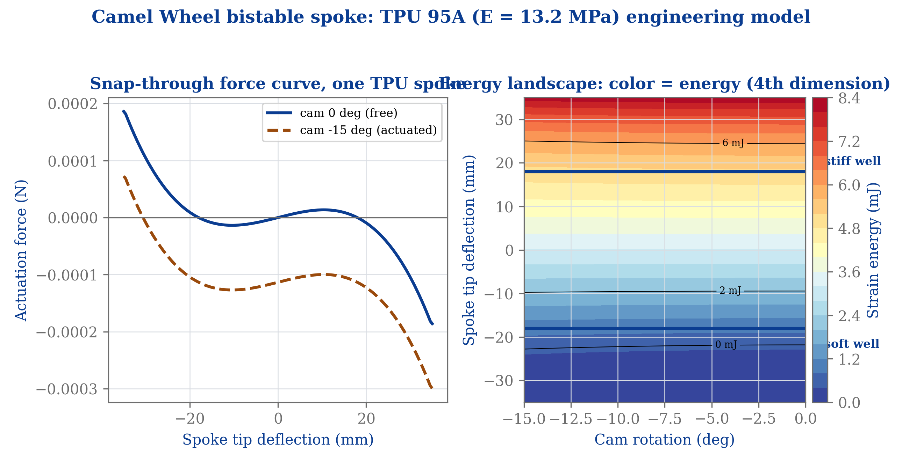
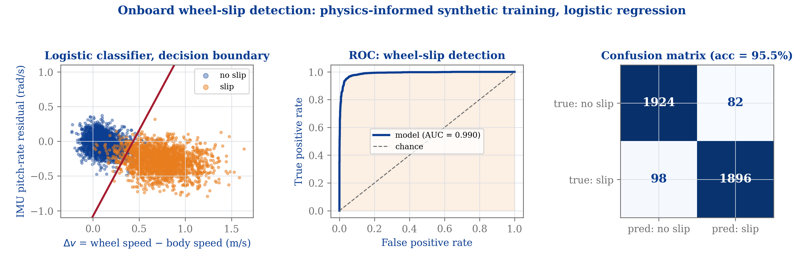

<div align="center">


# TEAM VANSH — NASA HERC 2027

**Remote-Controlled Division · High School Category**

*Simulation-driven design of a PEEK-aluminium rover with bistable compliant wheels*

[**Proposal (PDF)**](docs/vansh_herc_proposal.pdf) · [**Analysis code**](simulation/) · [**Apollo data**](data/) · [**CAD gallery**](cad/)

</div>

---

## What this repository is

The official engineering and analysis repository of **Team Vansh**, competing in NASA's **Human Exploration Rover Challenge (HERC) 2027** — Remote-Controlled Division, High School category (Marshall Space Flight Center; finals April 2027, U.S. Space & Rocket Center, Huntsville).

Everything quantitative behind our proposal lives here:

- **Terramechanics analysis fitted to real Apollo 16 lunar penetrometer data** (NASA PDS)
- **Bistable spoke simulation** behind our Camel Wheel design
- **Wheel-slip machine-learning study** for onboard detection
- **Lunar-gravity power budget** over a mock course
- **Granular-jamming gripper holding-force model**
- **Full CAD visual documentation**, assembly to individual parts

Every figure in the proposal is reproducible from `simulation/terramechanics_analysis.py`.

---

## Team

| Member | Role |
|---|---|
| **Saarth Agrawal** | Team Lead & Systems Engineer |
| Aayat Firdous | Design Engineer, Camel Wheel CAD |
| Aamish | Budget & Resource Officer; Safety Engineer |
| Shivaansh | Track (Tool & Payload) Engineer |
| Tirth | Fabrication & Integration Engineer |
| Aarush Gupta | Telemetry, Electronics & Software Engineer |

**Advisor:** Angad Singh Chopra · **Enrolling institution:** ALLEN Global, ALLEN, Kota, Rajasthan, India

---

## The rover

| Subsystem | Design |
|---|---|
| Frame | PEEK-aluminium hybrid space frame, ~60% lighter than steel equivalent |
| Wheels | 4 × **Camel Wheels** — bistable, non-pneumatic, driver-switchable stiff/soft modes |
| Drive | 4 × 24 V planetary gear motors, one per wheel, tank steering, ≥ 8 N·m continuous each |
| Task tool | Granular-jamming gripper (latex bladder + granular media + 12 V diaphragm pump) |
| Sensing | Wheel encoders, IMU, motor current, battery V/I, mast FPV camera |
| Compute | XIAO ESP32S3 supervising ESCs and gripper; laptop telemetry dashboard |
| Signature | Rehearsed **90-second pit stop** with quick-swap subsystems |

---

## Repository layout

```
teamvansh-herc-2027/
├── README.md
├── simulation/
│   └── terramechanics_analysis.py   # all six analyses, one runnable script
├── data/
│   ├── a16_index5.csv               # Apollo 16 SRP, Station 4 (background)
│   ├── a16_index6.csv               # SRP run 6 (bench, crater edge)
│   ├── a16_index7.csv               # SRP run 7 (bench, SW of rover)
│   └── a16_index8.csv               # SRP run 8 (downhill, north of rover)
├── figures/
│   ├── apollo/                      # pressure-sinkage fits + sinkage surface
│   ├── ml/                          # spoke energy landscape + slip detector
│   └── power/                       # power budget + gripper model
├── cad/
│   ├── assembly/                    # full rover: hero, exploded, cover art
│   ├── parts/                       # wheel + gripper CAD and alt views
│   └── details/                     # orthographic drawing, joints, 14 subsystem renders
└── docs/
    ├── vansh_herc_proposal.pdf      # full 12-page proposal
    └── team_patch.png               # mission patch
```

---

## 1. The data — real lunar measurements

The soil model is anchored to **real measurements made on the Moon**. We use the digitized tables of the **Apollo 16 Self-Recording Penetrometer** experiment (Station 4, 11–12 May 1972), from NASA's Planetary Data System, dataset **A16L-L-LSRP-2/3-SOIL-MECHANICS-V1.0**, via the WUSTL Lunar Data Node. Each CSV contains measured penetration **force (N)**, **stress (N/cm²)** and **depth (cm)**.

---

## 2. Pressure–sinkage: Bekker fits to Apollo data

Terramechanics models plate penetration as a power law: **p = k·zⁿ**. Fitting (log–log least squares) to each run:

| Run | k (kPa·cm⁻ⁿ) | n | R² |
|---|---|---|---|
| Index 6 (bench, crater edge) | ≈ 80 | 0.61 | 0.63 |
| Index 7 (bench, SW) | ≈ 60 | 0.68 | 0.69 |
| Index 8 (downhill, N) | ≈ 150 | 0.41 | 0.70 |

**Design takeaway:** lunar soil resists penetration strongly in the first centimetres and hardens with depth (n < 1) → static wheel sinkage will be small → our mass budget goes to **traction adaptivity** (the Camel Wheel), not extreme ground clearance.

`figures/apollo/figA_srp_bekker.png`

---

## 3. Wheel sinkage surface (lunar gravity)

Fitted parameters feed a Wong-style static sinkage relation across per-wheel load (5–120 N) and wheel diameter (15–40 cm), colored by contact pressure, with design points marked: 10-inch static, 12-inch static, 10-inch at 3× load transfer on a 20° climb.

**Design takeaway:** sinkage stays in the low single-digit centimetres across the envelope → the 9.5-inch clearance target is safe; the 10 vs 12-inch trade stays open pending torque margins.

`figures/apollo/figB_sinkage_surface.png`

---

## 4. Camel Wheel bistable spoke model

Spokes are TPU 95A leaf springs (E = 13.2 MPa, ISO 37 — Raise3D TDS). First-order cantilever stiffness k = 3EI/L³ (L = 90 mm, b = 8 mm, t = 3 mm) plus a quartic bistable potential with cam-angle bias reproduces both design states:

- **Stiff:** near-circular rim, small contact patch, low rolling resistance
- **Soft:** spokes snap through into an S-shaped arc, larger footprint on loose soil

Results: peak snap-through force ≈ **0.19 N per spoke** (~2–3 N on the cam ring) — a small actuator suffices; at −15° cam rotation the stiff-state well vanishes and all twelve spokes snap together.

`figures/ml/figC_bistable.png`

---

## 5. Onboard wheel-slip detection (ML)

**Physics-informed synthetic dataset** (4,000 samples; slip states from a regolith-traction model, noise matched to hobby-grade IMU/encoder specs). Logistic regression on Δv (wheel − body speed) and IMU pitch-rate residual:

| Metric | Result |
|---|---|
| ROC AUC | **0.99** |
| Accuracy @ 0.5 | **95.4%** |
| Missed slips | 188/2,000 |
| False alarms | 82/2,000 |

Reduces to a two-coefficient threshold — runs **every control tick on the XIAO ESP32S3**, cutting motor command when slip is detected.

`figures/ml/figD_slip_ml.png`

---

## 6. Lunar-gravity power budget

66 m mock course (0/10°/20° segments), Crr = 0.18, 0.5 m/s, drivetrain η = 0.6, 6 W electronics, 6S 10 Ah pack:

- Peak draw on 20° climbs: **≈ 3.7 A**
- Flats: **≈ 1 A**
- SOC at course end: **99.2%**

**Design takeaway:** pack sized with wide margin for a full day of runs → no heavier battery, saving mass inside the 60 lb envelope.

`figures/power/figE_power.png`

---

## 7. Granular-jamming gripper holding force

**F = α · ΔP · π r²**, α = 0.35 (bench-plan estimate). At 60 kPa vacuum on a 40 mm-radius target: holding force > **100 N** — an order of magnitude above task requirements, so **pump-current sensing alone** is a reliable jam-success check.

`figures/power/figF_gripper.png`

---

## 8. Reproduce everything

```bash
git clone https://github.com/<org>/teamvansh-herc-2027.git
cd teamvansh-herc-2027
pip install numpy matplotlib
python3 simulation/terramechanics_analysis.py
```

Figures regenerate into `figures/…` exactly as committed. Runtime: a few seconds. Dependencies: NumPy, Matplotlib only. All random draws seeded.

---

## 9. CAD documentation

### Assembly — `cad/assembly/`
| File | View |
|---|---|
| `rover_full_render.png` | Hero studio render |
| `rover_exploded.png` | Exploded: frame, wheels, mast, gripper, batteries |
| `cover_art.png` | Proposal cover artwork |

### Parts — `cad/parts/`
| File | View |
|---|---|
| `wheel_cad.png` | Camel Wheel CAD model |
| `wheel_low_angle.png` | Camel Wheel, low-angle render |
| `gripper_cad.png` | Gripper arm CAD |
| `gripper_alt.png` | Gripper, alternate view |

### Details — `cad/details/` (16 files)
| File | View |
|---|---|
| `wheel_orthographic.png` | 1:5 drawing: Ø400 × 80 mm, 20 mm hub, 10 mm tread |
| `joint_render.png` | ROVER-JOINT-04: machined socket + QR pin |
| `chassis_layout.png` | Top/bottom views, steering detail, RC config |
| `cad_frame_blueprint.png` | Bare space frame, blueprint style |
| `cad_wheel_exploded.png` | Tread ring + hub exploded |
| `cad_wheel_contact.png` | Wheel deforming in simulant |
| `cad_drivetrain_hub.png` | Corner drivetrain cutaway |
| `cad_electronics_deck.png` | Battery deck top-down |
| `cad_mast_assembly.png` | Mast + camera head |
| `cad_gripper_macro.png` | Bladder gripping a rock (macro) |
| `cad_iso_rear.png` | Rear-top three-quarter |
| `part_frame_only.png` | Bare space frame |
| `part_wheels_set.png` | Wheel set of 4 |
| `part_joint_family.png` | Joint hardware family |
| `part_mast_alone.png` | Mast alone |
| `part_gripper_arm.png` | Gripper arm alone |
| `part_battery_deck.png` | Battery boxes alone |

---

## 10. Design gallery

| | |
|:---:|:---:|
|  |  |
| *Full assembly* | *Exploded view* |
|  |  |
| *Camel Wheel 1:5 drawing* | *Bare space frame* |
|  |  |
| *Bistable energy landscape* | *Slip-detection ROC* |

---

## Acknowledgements

- **NASA Planetary Data System** / PDS Lunar Data Node (WUSTL) — Apollo 16 SRP dataset A16L-L-LSRP-2/3-SOIL-MECHANICS-V1.0
- **Raise3D** — Premium TPU-95A technical data sheet
- **NASA HERC** organizers, Marshall Space Flight Center

## License

Analysis code: **MIT License**. Apollo 16 data: NASA PDS usage terms.

<div align="center">

*Team Vansh · See you in Huntsville, April 2027.*

</div>
